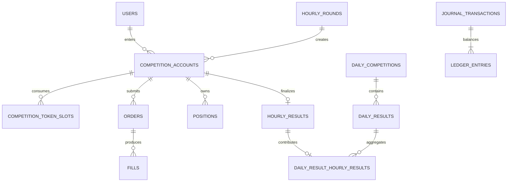

# Phase 2: Authoritative Hourly Ledger and Competition Schema

## Scope and correction history

PostgreSQL is the authoritative source for competition accounts, balances, orders, fills, positions, hourly results, daily aggregation, and ledger history. Redis has no authoritative financial role.

The original Phase 2 implementation incorrectly modeled monthly seasons and paper-capital top-ups. Because the repository is pre-production and contains no user financial data, migration `0001` was cleanly regenerated from the retained Phase 0 migration. The corrected model has no monthly competition account, monthly reset, top-up API, top-up field, or `TOP_UP_CAPITAL` ledger code. This replacement is intentionally a development-history correction and is not a production migration pattern.

## Authoritative tables

| Table                         | Purpose                                                             |
| ----------------------------- | ------------------------------------------------------------------- |
| `users`                       | Durable participant identity and unique wallet address              |
| `hourly_rounds`               | Non-overlapping UTC hour windows and immutable rule snapshots       |
| `daily_competitions`          | One canonical UTC-day window per date                               |
| `competition_accounts`        | One fresh financial account per user and hourly round               |
| `competition_token_slots`     | Immutable first-successful-buy token usage for an hourly account    |
| `assets`                      | Durable mint identity and token decimals                            |
| `markets`                     | Venue-independent base/quote market identity                        |
| `idempotency_records`         | Operation/key uniqueness, request hash, and original result         |
| `orders`                      | Requested buy/sell intent and lifecycle                             |
| `fills`                       | Immutable simulated execution history                               |
| `positions`                   | Materialized weighted-average holding per hourly account and market |
| `journal_transactions`        | Immutable balance-change headers                                    |
| `ledger_entries`              | Immutable exact-lamport debit/credit lines                          |
| `hourly_results`              | One immutable settled result per hourly account                     |
| `daily_results`               | Materialized cumulative UTC-day P&L per user                        |
| `daily_result_hourly_results` | Immutable proof of each hourly contribution                         |

`app_meta` remains the retained Phase 0 table.



## Hourly and daily boundaries

Every `hourly_rounds` row is exactly one UTC-aligned hour. A GiST exclusion constraint rejects overlapping windows. The row snapshots starting Paper SOL, maximum unique tokens, maximum buy ratio in basis points, reward-finalization grace seconds, and rule version so an open round never depends on later global configuration changes.

Every user may have at most one `competition_accounts` row for a round. Initialization copies the round's configured starting balance—10,000,000,000 lamports by default—into a new account and balanced starting-credit journal. Accounts do not carry cash, positions, token slots, or losses into another hour. There is no operation that replenishes a losing hourly account; the user waits for the next round and receives a separate fresh account.

`daily_competitions` enforce exact UTC calendar-day windows and unique UTC dates. Finalized hourly results are attributed only by their hourly round's authoritative start time. Settlement completion and result insertion after midnight do not change attribution.

`daily_results` holds the cumulative sum and completed-hour count. Each immutable `daily_result_hourly_results` row links one hourly result to one daily result. A unique hourly-result constraint and database identity trigger prevent double counting or attribution to the wrong user/day.

## Canonical units and accounting

- Paper SOL is stored as signed PostgreSQL `bigint` lamports and TypeScript `bigint`; 1 SOL is exactly 1,000,000,000 lamports.
- Token quantities use integer base units. `assets.decimals` is display metadata.
- Execution prices use `numeric(38,18)` and validated decimal strings.
- JavaScript `number` is never authoritative for money, token quantities, fees, cost basis, or P&L.

Each balance-changing operation creates an immutable journal and at least two immutable entries. Deferred database triggers verify at commit that entries use the journal's competition account, contain positive amounts, and have equal debit and credit totals. Account codes are:

- `CASH`;
- `POSITION_COST`;
- `HOURLY_STARTING_CAPITAL`;
- `TRADING_PNL`;
- `TRADING_FEES`.

The invariant for an active or finalized hourly account is:

```text
paper SOL cash + open position cost
= hourly starting capital + gross realized trading PnL - realized sell fees
```

The starting journal is `HOURLY_STARTING_CREDIT`. Buys exchange `CASH` for `POSITION_COST`; buy fees are included in acquisition cost. Sells return net proceeds to `CASH`, remove `POSITION_COST`, record gross `TRADING_PNL`, and record sell fees in `TRADING_FEES`. Later forced-settlement fills can use the same sell accounting and immutable fill history.

## Orders, fills, positions, and token slots

Orders and positions reference an hourly `competition_account_id`. Orders record intent; fills record execution. One order may have multiple fills, but aggregate fills cannot exceed the requested quote value or base quantity. Completed, cancelled, rejected, and finalized-account orders cannot accept new fills.

Positions use the identity of competition account plus market; the market carries the protocol/venue and base asset identity. Repeated buys use weighted-average aggregate cost:

```text
buy acquisition cost = quote lamports + buy fee lamports
partial-sell cost removed = floor(old cost × sold quantity / old quantity)
final-sell cost removed = all remaining cost
fill realized PnL = quote lamports - sell fee lamports - cost removed
```

Partial division leaves integer remainder with the open position; the final sell removes the exact remainder. Closed positions remain as zero-quantity, zero-cost historical materializations while fills remain the execution source of truth.

A first successful buy inserts one immutable token-slot row keyed by hourly account and asset mint identity. Selling never removes the slot. The account row lock serializes first-entry races and compares persisted usage with the round's snapshotted maximum. Symbols are never identity.

## Results and reconciliation

`finalizeHourlyResult` requires every position to be closed and the submitted final balance to equal authoritative cash. It persists:

```text
hourly PnL = final settled balance - snapshotted starting balance
```

The account finalization fields and immutable hourly result must agree; a database trigger enforces their round, user, starting balance, final balance, and P&L identity.

`reconcileAccountLedger` proves materialized cash equals ledger cash, open cost equals ledger position cost, signed fill quantity equals position quantity, realized P&L equals gross trading P&L less sell fees, starting capital equals the round-account snapshot, and every journal balances.

## Idempotency, transactions, and locking

The unique `(operation_class, idempotency_key)` constraint is the duplicate barrier. Canonical SHA-256 request fingerprints detect conflicting reuse. Same-key/same-payload calls return the original result; conflicting payloads fail.

Implemented operation classes cover hourly-account initialization, order submission, fill application, hourly-result finalization, and daily-result contribution. There is no top-up operation.

Financial mutations are single PostgreSQL transactions. Initialization coordinates idempotency, the one-user/round constraint, the fresh balance, and starting journal. Order admission locks the authoritative round state and accepts intent only while it is `OPEN`. Fill application locks order then account, token slots, and position before updating the fill, cash, P&L, journal, order state, and idempotency result. Result finalization and daily contribution similarly lock their authoritative aggregates. Any failure rolls back every partial mutation.

## Deletion and immutability

All authoritative foreign keys use `ON DELETE RESTRICT ON UPDATE RESTRICT`. Database triggers reject updates or deletes of token slots, fills, hourly results, daily contribution links, journal headers, and ledger entries. Daily result totals and live account/position/order state are materialized transactional state; history rows remain the reconstructable evidence.

## Test coverage

Real-PostgreSQL tests create an isolated database, apply Phase 0 then corrected Phase 2, migrate again, and drop only that isolated database. They cover:

- separate fresh 10 SOL accounts for consecutive hours;
- no balance carry and no top-up API/account code;
- duplicate hourly initialization;
- exact/non-overlapping hour and UTC-day constraints;
- token-slot uniqueness and first-entry limit races;
- order/fill/position hourly ownership;
- duplicate orders and fills;
- concurrent overspending and distinct same-position fills;
- rollback, immutable history, and deferred journal balance;
- weighted-average partial/final sells and ledger reconciliation;
- exact immutable hourly results;
- cumulative negative and zero daily results without double counting;
- 23:00–00:00 attribution to the UTC date containing 23:00.

The complete repository suite contains 200 passing tests: 186 retained Phase 1 tests and 14 corrected Phase 2 PostgreSQL tests.

## Deferred work

Phase 2 does not implement protocol pricing, bonding curves, AMMs, slippage, market-state capture, forced-settlement orchestration, rankings, rewards, chain watchers, payouts, custody, or real trading. The persisted 20% ratio supports later enforcement, but marked portfolio valuation and the maximum-new-buy transaction remain Phase 3 work. Creator-fee, prize-pool, Reward Buffer, and payout tables are deferred to their planned phases rather than being overbuilt here.

## Recommended next task

Build only the Phase 3 execution-engine abstraction: normalized immutable market-state, quote, fill, fee, price-impact, and adapter-version contracts; deterministic fake/reference adapters and replay fixtures; and authoritative transactional enforcement of the configured 20% maximum new buy using the Phase 2 hourly account. Do not add live Solana trading, creator-fee ingestion, or payouts.
