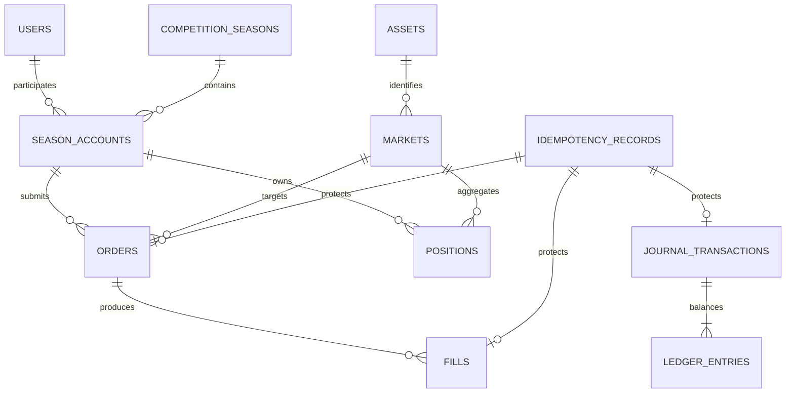

# Phase 2: Authoritative Ledger and Trading Schema

## Scope and existing architecture

Phase 1 already provided a Node.js/TypeScript monorepo, Drizzle ORM with `node-postgres`, forward-only SQL migrations, caller-supplied text identifiers, UTC-aware timestamps, an `app_meta` table, and PostgreSQL/Redis readiness infrastructure. Phase 2 extends that architecture; it does not introduce a second persistence stack. Redis retains no authoritative financial responsibility.

This phase supplies durable state and narrow transactional APIs. It does not implement price discovery, slippage, portfolio marking, competition ranking, payouts, custody, or live Solana execution.

## Authoritative model

PostgreSQL is the source of truth. The model adds:

| Table                  | Purpose                                                             |
| ---------------------- | ------------------------------------------------------------------- |
| `users`                | Durable participant identity and unique wallet address              |
| `competition_seasons`  | Versioned UTC monthly accounting/competition containers             |
| `season_accounts`      | One materialized financial account per user and season              |
| `assets`               | Mint identity, decimals, optional display metadata, source metadata |
| `markets`              | Venue-independent base/quote market identity                        |
| `idempotency_records`  | Operation class, key, request hash, completion, and result identity |
| `orders`               | Requested buy/sell intent and lifecycle                             |
| `fills`                | Immutable simulated executions; one order may have many fills       |
| `positions`            | Materialized weighted-average position state per account and market |
| `journal_transactions` | Immutable headers for balance-changing operations                   |
| `ledger_entries`       | Immutable debit/credit lines in exact lamports                      |

`app_meta` remains unchanged.



## Canonical units and precision

- SOL and all paper-SOL values use signed PostgreSQL `bigint` lamports and TypeScript `bigint`. One SOL is exactly 1,000,000,000 lamports.
- Token quantities use integer base units (`bigint`). `assets.decimals` records how to display them.
- Execution prices use `numeric(38,18)` and cross the service boundary as validated decimal strings.
- JavaScript `number` is never authoritative for balances, quantities, fees, cost basis, or PnL.
- All event timestamps use PostgreSQL `timestamp with time zone`; monthly boundaries are constructed and validated as exact UTC calendar boundaries.

## Double-entry ledger

Every balance-changing operation creates one immutable `journal_transactions` row and at least two immutable `ledger_entries` rows. Entries use these account codes:

- `CASH`: paper SOL held by the season account.
- `POSITION_COST`: lamport cost carried by open positions.
- `STARTING_CAPITAL`: the season's initial injected capital.
- `TOP_UP_CAPITAL`: later injected paper capital, kept separate from performance.
- `TRADING_PNL`: gross realized trading gain or loss.
- `TRADING_FEES`: realized sell-side fee expense.

The database installs deferred constraint triggers. At commit, every affected journal must have at least two rows, positive amounts, the same season account as its journal header, and equal debit and credit totals. Database triggers reject updates or deletes of journal headers, ledger entries, and fills. All authoritative foreign keys use `ON DELETE RESTRICT ON UPDATE RESTRICT`.

Materialized balances and positions exist for transactional reads, but the ledger remains independently reconcilable. The core equation is:

```text
cash + open position cost
= starting capital + top-up capital + gross realized trading PnL - realized sell fees
```

The reconciliation API also verifies:

```text
materialized cash = ledger CASH balance
materialized open cost = ledger POSITION_COST balance
materialized quantity = buys in fills - sells in fills
materialized realized PnL = gross realized trading PnL - realized sell fees
every journal debits = every journal credits
```

Buy fees are capitalized into the acquired position's cost. Sell fees are recorded as `TRADING_FEES`. Consequently, all fees reduce eventual realized PnL without being counted twice.

## Season accounts, allocations, and top-ups

A unique constraint enforces one `season_accounts` row per `(user_id, season_id)`. Initialization creates a new historical season row instead of resetting or rewriting an earlier season. Each initialized account receives exactly 10,000,000,000 lamports through a balanced `STARTING_ALLOCATION` journal. Both the uniqueness constraint and idempotency record prevent duplicate capital.

Top-ups debit `CASH` and credit `TOP_UP_CAPITAL`. They increase `cumulative_top_up_lamports` but never change historical fills or realized PnL. Future leaderboard calculations can therefore exclude injected capital. Simultaneous top-ups lock the account row and serialize safely.

## Orders, fills, positions, and cost basis

An order stores intent: account, market, side, requested quote value for buys or requested base quantity for sells, timestamps, status, and idempotency identity. A fill stores execution: base units, quote lamports, decimal price, fees, execution identity, cost removed, realized PnL, and authoritative execution time. Aggregate fills may not exceed the order request; completed, rejected, and cancelled orders reject new fills.

One materialized position exists per account and market. Repeated buys add quantity and total acquisition cost. The V1 method is weighted-average aggregate cost basis:

```text
buy acquisition cost = quote lamports + buy fee lamports
new quantity = old quantity + bought base units
new cost = old cost + acquisition cost

partial-sell cost removed = floor(old cost * sold quantity / old quantity)
final-sell cost removed = all remaining cost
net proceeds = quote lamports - sell fee lamports
fill realized PnL = net proceeds - cost removed
```

Flooring partial cost removal preserves integer lamports; all residual cost remains with the open position. A final close removes the exact remainder, guaranteeing no cost-basis dust disappears. A closed position has zero quantity and zero cost, while historical fills remain unchanged.

## Idempotency

The unique `(operation_class, idempotency_key)` constraint is the final duplicate barrier. A SHA-256 hash of the canonical request payload detects conflicting reuse. The same key and request waits on and returns the original result; the same key with another payload raises `IDEMPOTENCY_CONFLICT`. PostgreSQL, rather than process memory, coordinates simultaneous requests.

Implemented operation classes are season-account initialization, paper top-up, order submission, and fill application. The table and conventions are ready for settlement, reset/finalization, and reward application operations in later phases.

## Transactions and locking

Each mutation uses one PostgreSQL transaction:

- Initialization claims idempotency, establishes unique account state, writes the 10 SOL journal, and completes idempotency atomically.
- Top-up locks the season account, claims idempotency, updates both materialized capital fields, writes the journal, and completes idempotency.
- Order submission claims idempotency and inserts intent atomically.
- Fill application locks the order and season account, locks or creates the position, verifies cumulative fill limits and available capital/quantity, inserts the fill, updates the position and account, writes the journal, updates order status, and completes idempotency.

Failures roll the complete transaction back. Account row locks serialize competing debits and credits. Order locks serialize duplicate or partial fill application. Position updates occur only while the owning account is locked, giving one consistent lock order and preventing money creation, double application, overspending, and lost updates.

## Constraints and deletion policy

Primary keys, unique execution IDs, unique mint identities, unique venue/provider markets, one account per user/season, one position per account/market, and unique idempotency relations protect identity. Checks protect positive quantities and amounts, nonnegative balances and fees, valid states/sides, order request shape, distinct market assets, asset decimals, timestamps, and open/closed position consistency.

Authoritative history is preservation-first. Foreign-key cascades are not used. Parent deletion is restricted when financial children exist. Fills, journals, and ledger rows are additionally trigger-immutable. Lifecycle status/finalization transitions are the intended alternative to deletion.

## Reconciliation and tests

The real-PostgreSQL integration suite creates an isolated temporary database, migrates it twice, and removes the database after the suite. It exercises database constraints and actual lock/uniqueness behavior rather than mocks. The deterministic reconciliation scenario performs two buys, buy fees, a partial sell, sell fees, a paper top-up, and a final close. It proves a final cash balance of 14 SOL, separately measurable 3 SOL injected capital, 1 SOL realized PnL, zero remaining quantity/cost, exact fill-derived quantity, and a fully balanced ledger.

Concurrency coverage includes simultaneous debits, duplicate top-ups, different concurrent top-ups, simultaneous initialization, duplicate order submission, duplicate fill application, two different fills into one position, and forced rollback after a partial mutation.

## Later-phase integration

- **20% buy cap:** a later transaction must lock/read the season account and relevant positions, obtain one authoritative market snapshot, compute marked portfolio value, compare requested buy value to the configured cap, and then create/apply execution without changing the lock order.
- **Unique-token/hour limit:** orders and fills retain account, market/token, side, and UTC timestamps, allowing deterministic distinct-token counting. The configurable limit belongs in versioned rules, not a schema check.
- **Monthly reset/finalization:** later orchestration may finalize the current season, settle open positions, preserve every historical row, create the next UTC season, and initialize a fresh 10 SOL account. It must not rewrite old seasons.
- **Competition accounting:** starting and top-up capital are separate from trading PnL, so ranking logic can measure performance without treating injected capital as skill.

## Known limitations

- Execution pricing, slippage, liquidity, bonding curves, AMMs, and live Solana data are intentionally absent.
- The service supports buy and sell fills but does not expose standalone administrative correction, position-close, season-finalization, settlement, or reward APIs yet.
- Buy-cap valuation, unique-token/hour enforcement, hourly competition linkage, leaderboard scoring, and payouts belong to later phases.
- Lifecycle transitions beyond the implemented order flow are represented by schema states but not yet exposed as domain operations.
- Caller-supplied identifiers remain the repository convention; globally distributed ID generation is not part of this phase.

## Recommended Phase 3

Build the execution-engine abstraction around deterministic market snapshots and protocol adapters. Define a pure execution quote/result contract, add a pump.fun-compatible simulator behind that contract without live trading, enforce fee/slippage/partial-fill outputs, and connect successful results exclusively through `createOrder` and `applyFill`. In the same transaction boundary, add the authoritative 20% buy-cap calculation and configurable five-unique-token-per-UTC-hour enforcement, with real PostgreSQL concurrency tests.
